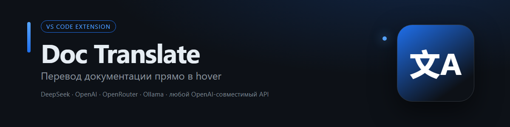
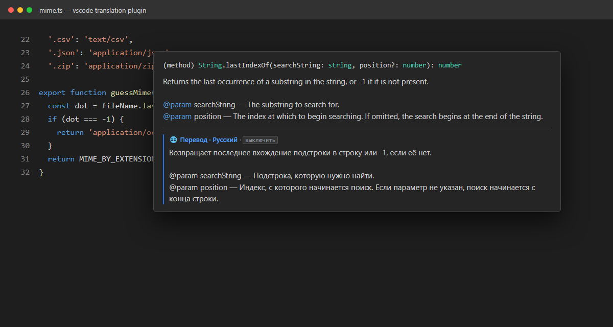

<p align="center">
  
</p>

<h1 align="center">Doc Translate</h1>

<p align="center">
  Перевод документации прямо в hover-подсказке VS Code.<br>
  <em>Translates hover documentation in VS Code into Russian or any configured language.</em>
</p>

<p align="center">
  <a href="https://github.com/lyzhenko/doctranslate/actions/workflows/ci.yml">
    
  </a>
  <a href="LICENSE">
    
  </a>
  
  
</p>

---

## Что это

Расширение добавляет перевод в стандартную всплывающую подсказку VS Code. Наведите курсор на
функцию, тип или свойство — под английским описанием появится перевод, а код, имена параметров и
ссылки останутся нетронутыми.



<sub>Схема: перевод добавляется отдельным блоком под оригинальной документацией.</sub>

## Возможности

- **Перевод в hover** — JSDoc, TSDoc, docstring и описания типов.
- **Любой язык** — `docTranslate.targetLanguage`, по умолчанию `ru`.
- **Код остаётся кодом** — блоки кода, inline-код, URL, HTML-теги и имена типов маскируются перед
  запросом и восстанавливаются после ответа.
- **Кэш и дедупликация** — повторное наведение на символ не тратит токены; одновременные запросы
  объединяются.
- **Любой OpenAI-совместимый API** — DeepSeek, OpenAI, OpenRouter, Ollama и другие.
- **Ключ в SecretStorage** — API-ключ не попадает в `settings.json` и не пишется в журнал.
- **Никакой телеметрии** — содержимое документации не логируется.

## Установка

### Из VSIX

Соберите пакет:

```powershell
git clone https://github.com/lyzhenko/doctranslate.git
cd doctranslate
npm ci
npm run package
code --install-extension .\doc-translate-0.1.1.vsix
```

Готовые сборки также публикуются в [Releases](https://github.com/lyzhenko/doctranslate/releases)
при push тега `v*`.

### Из исходников (для разработки)

```powershell
npm ci
npm run compile
```

Откройте папку в VS Code и нажмите **F5** — запустится Extension Development Host.

## Быстрый старт

1. `Ctrl+Shift+P` → **Doc Translate: Настроить провайдера перевода**.
2. Выберите **DeepSeek** (или OpenAI / OpenRouter / Ollama).
3. Вставьте API-ключ — он сохранится в защищённом хранилище VS Code.
4. Наведите курсор на любую функцию с документацией, например `fileName.lastIndexOf('.')`.

Ключ можно задать и переменными окружения: `DOC_TRANSLATE_API_KEY`, а для DeepSeek также
`DEEPSEEK_API_KEY` — они используются, если в SecretStorage ничего нет.

## Команды

| Команда (палитра) | Что делает |
|---|---|
| `Doc Translate: Включить или выключить перевод документации` | Быстро включает/выключает перевод |
| `Doc Translate: Настроить провайдера перевода` | Выбор провайдера и модели, ввод ключа |
| `Doc Translate: Установить API-ключ` | Заменить ключ для текущего API |
| `Doc Translate: Выбрать язык перевода` | Русский, английский, немецкий, … или свой код |
| `Doc Translate: Очистить кэш переводов` | Сбрасывает кэш переводов |
| `Doc Translate: Показать журнал` | Канал вывода `Doc Translate` с диагностикой |

Индикатор `🌐 RU` в статус-баре показывает язык, крутится во время запроса и открывает меню по
клику. Ссылка **«выключить»** есть и в самом hover.

## Настройки

| Ключ | По умолчанию | Описание |
|---|---|---|
| `docTranslate.enabled` | `true` | Добавлять перевод в hover |
| `docTranslate.targetLanguage` | `ru` | Код языка перевода |
| `docTranslate.apiBaseUrl` | `https://api.deepseek.com/v1` | Базовый URL OpenAI-совместимого API |
| `docTranslate.model` | `deepseek-chat` | Имя модели |
| `docTranslate.apiKeyRequired` | `true` | Требовать ключ; выключите для Ollama |
| `docTranslate.timeoutMs` | `15000` | Таймаут запроса, мс |
| `docTranslate.maxDocChars` | `6000` | Документация длиннее лимита не переводится |

Пример для локальной модели:

```jsonc
{
  "docTranslate.apiBaseUrl": "http://localhost:11434/v1",
  "docTranslate.model": "qwen2.5-coder:7b",
  "docTranslate.apiKeyRequired": false
}
```

## Как это работает

1. При наведении расширение спрашивает у VS Code все стандартные hover-провайдеры
   (`vscode.executeHoverProvider`) и собирает документацию.
2. Markdown разбивается на прозу и код. Блоки кода, inline-код, ссылки и HTML-теги заменяются
   маркерами вида `⟦B0⟧`, `⟦C1⟧`, `⟦U2⟧` — в API уходит только естественный язык.
3. Запрос идёт в `/chat/completions` выбранного провайдера; модель обязана сохранить все маркеры и
   markdown-разметку.
4. Если маркер потерян, выполняется один повторный запрос; если и он не помог — перевод не
   показывается, чтобы не сломать код.
5. Оригинальные фрагменты возвращаются на место, результат кэшируется и добавляется отдельным блоком
   под исходным hover.

**Приватность.** В API отправляется только текст документации, без кода и URL. Ключ хранится в
SecretStorage. Журнал содержит только служебные сообщения (длины, время, коды ошибок), без текста
документации.

## Ограничения

- переводится только hover; комментарии в редакторе на месте не переводятся;
- первый hover символа ждёт ответа API (обычно 0,5–3 с), дальше работает кэш;
- очень длинная документация (> `maxDocChars`) пропускается;
- провайдер должен поддерживать OpenAI Chat Completions API;
- переводы кэшируются в памяти до перезагрузки окна.

## Разработка

Требования: Node.js 22+, npm 10+.

```powershell
npm ci
npm run compile      # tsc
npm test             # 32 теста (node:test)
npm run e2e          # офлайн-проверка пайплайна на локальном фейковом API
npm run package      # .vsix через vsce
```

Структура:

```
src/
  extension.ts       точка входа и регистрация провайдера
  hoverProvider.ts   сбор документации, защита от рекурсии, отрисовка перевода
  translator.ts      кэш, маскирование, валидация, повторный запрос
  markdown.ts        разбор Markdown и маркеры кода/ссылок
  prompt.ts          системный промпт и сообщения
  llm.ts             HTTP-клиент OpenAI-совместимого API, таймауты и ошибки
  commands.ts        команды и QuickPick-настройка
  statusBar.ts       индикатор и меню
  config.ts          чтение и нормализация настроек
  language.ts        названия языков и эвристика «уже переведено»
test/                юнит-тесты
scripts/e2e.ts       офлайн end-to-end проверка
```

Вклад приветствуется: см. [CONTRIBUTING.md](CONTRIBUTING.md).

## Лицензия

[MIT](LICENSE) © 2026 lyzhenko
